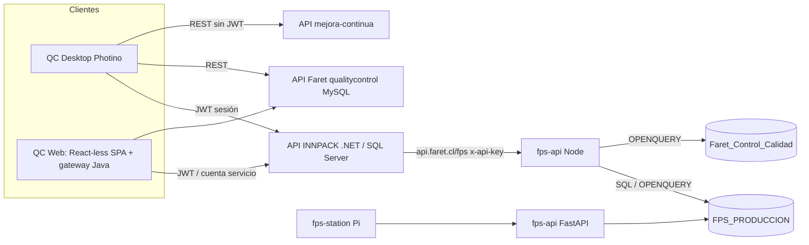

# 01 — Diagnóstico de sistemas

**Fecha:** 10-11-2026 · **Modalidad:** solo lectura (código, configuración sin secretos, SELECT agregados sobre FPS). Sin cambios en ningún sistema.
**Leyenda:** CONFIRMADO = verificado en código o datos · INFERIDO = deducción pendiente de validar · PENDIENTE = requiere acceso/decisión · PROPUESTA = recomendación.

## 1. Alcance y limitaciones de acceso

| Fuente | Acceso en esta auditoría | Consecuencia |
|---|---|---|
| Código de los repos locales (Desktop, Web, APIs INNPACK/Faret/mejora-continua, FPS-Python, fps-api Node, programa-produccion) | Lectura | Hallazgos CONFIRMADOS |
| SQL Server `FARET_PRODUCCION` (SAP) y, vía linked server, `FPS_PRODUCCION` | SELECT agregados | Cobertura FPS CONFIRMADA (30/90 días) |
| BD `calidad` INNPACK (`no_conformidades`), `importacion_pnc` Faret, `registros_*` | **Sin acceso autorizado desde esta sesión** | Cobertura de operador/fecha de fabricación/nivel en NC = **PENDIENTE** (consultas Q1–Q6 en `02_MAPEO_DATOS_CORRELACION.md` §6) |

## 2. Inventario de componentes

| # | Componente | Tecnología | Rol respecto al módulo | Evidencia |
|---|---|---|---|---|
| A | **QC Desktop** (Photino) | .NET 8 + SPA JS vanilla | Cliente de NC; puente JS↔C#; permisos por módulo | `src/Backend/Services/MessageRouter.cs`, `PermisosService.cs`, `Modules/NoConformidades/NoConformidadesHandler.cs` |
| B | **QC Web** (gateway Java) | Spring Boot (`cl.faret.qccweb`) sirviendo el **mismo frontend de Photino** (`web-dist/photino-www`, sync con `tools/sync-photino-www.ps1`) | Réplica de acciones Desktop; sin persistencia propia | `qualitycontrol_web_faret/backend/.../bridge/BridgeConfig.java`, `bridge/handlers/*` (26 handlers) |
| B' | Frontend React `frontend/`, `database/`, paquete `cl.faret.qcc` (JPA/MySQL) | — | **Legado congelado, no usado** (CONFIRMADO: `@Entity` solo en ese paquete) | ídem |
| C1 | **API INNPACK** | .NET 8, SQL Server, JWT | Dueña de `no_conformidades` (INNPACK + NC internas) | `qualitycontrolinnpack_sqlserver_port/.../Repositories/NoConformidadesRepository.cs` (SQL Server: `OFFSET/FETCH`) |
| C2 | **API Faret `qualitycontrol`** | .NET 8, MySQL `qualitycontrolfaret`, JWT | Dueña de `importacion_pnc` (datos de PNC Faret) | `apiqualitycontrolfaret/.../Repositories/ImportacionesRepository.cs`, `Sql/2026_importaciones.sql` |
| C3 | **API `mejora-continua`** | .NET 8 + Dapper, sin JWT | Gestión vinculada de NC Faret (`nc_no_conformidades`) | `mejoracontinua.api/MejoraContinua.Api/Models/NoConformidad.cs` |
| C4 | API `calidad` (Node) | Node/Express | Inspecciones Faret móvil (`registros_calidad_faret`) | CLAUDE.md del repo Desktop (no re-verificado en este análisis) |
| D1 | **FPS-Python / fps-station** | Python, Raspberry Pi 3B, PySide6, SQLite local | Captura de producción por máquina (sesiones) | `FPS-Python/fps-station`, `INVENTARIO_ESTACIONES.md` |
| D2 | **FPS-Python / fps-api** | FastAPI → SQL Server `FPS_PRODUCCION` | API de estaciones; reglas de cierre | `fps-api/src/fps_api/routers/{auth,productions,workorders}.py` |
| D3 | **fps-api (Node)** | Node/Express, `api.faret.cl/fps`, `x-api-key` | Lecturas FPS ya usadas por QCC (Talleres Externos, liberaciones, laboratorio) | `Proyectos/fps-api/fps-api/src/routes/produccion.routes.js` |
| D4 | FPS-WEB / FPS-Desktop (VB.NET) | WebForms / WinForms | Legado, SQL directo, sin API | `FPS-WEB`, `FPS-Desktop` |
| D5 | fps-analyzer | Python CLI | Reporte estático por OT; no es host de dashboard | `FPS-Python/fps-analyzer` |
| D6 | programa-produccion (Planificación) | API en `api.faret.cl/programa-produccion` | Planificación por NP; vía API INNPACK con gateway token (fix 1.8.25) | CLAUDE.md Desktop; repo sin `src` (no auditado) |
| E | Vistas materializadas FPS `plan.*` | SQL Server | `plan.FactSesionKpi` (122.019 filas, 2004–2026, Operador/NP/Máquina/CalidadPct), `plan.vw_FactProduccion`, `plan.CalidadPncHistorico` | SELECT agregados (CONFIRMADO) |

## 3. Arquitectura real (CONFIRMADO)

Puntos clave:
- El Desktop **no** accede a la BD de NC INNPACK: es passthrough REST (`NoConformidadesHandler.BuildBody`/`Forward` → `InnpackApiClient`). CONFIRMADO. El `DbService` MySQL del Desktop sigue vivo para `RegistrosControl`, `Dashboard`, `Trazabilidad/Paletizado`.
- La Web **no tiene persistencia propia**; cada acción `modulo.accion` se atiende en un `*BridgeHandler` que llama a las APIs (`upstream/*`). Hay lógica portada de Photino (p. ej. `FaretDashboardResumen.java`, "port fiel" de `FaretDashboardService`). CONFIRMADO.
- Paridad Desktop↔Web: `tools/release-web.ps1` exige portar cada acción nueva dos veces. CONFIRMADO.
- Faret opera con dos fuentes para una misma NC: `importacion_pnc` (datos, MySQL) + `nc_no_conformidades` (gestión, mejora-continua), unidas en memoria en el frontend (`faret-nc.controller.js::_normalizarFila`). CONFIRMADO.

## 4. Fuentes de verdad por entidad

| Entidad | Fuente de verdad | Observación |
|---|---|---|
| NC de producto INNPACK | `no_conformidades` (SQL Server, `ambito='PRODUCTO'`) | `severidad` se deriva de `nivel` en el frontend (`_mapNivelASeveridad`) |
| NC internas (ambas empresas) | `no_conformidades` con `ambito='INTERNA'` + `empresa` | **No capturan operador, nivel ni fecha de fabricación** (`CrearInternaAsync`) → fuera del universo del índice |
| NC/PNC Faret | `importacion_pnc` | Aquí viven `nivel`, `operador`, `fecha_fabricacion`. `nc_no_conformidades.severidad` ≠ nivel |
| Operador de producción | `ZZZUsuarios` (FPS): `ID`, `Rut` | Clave estable = RUT (449 usuarios, 438 RUT distintos, 11 repetidos) |
| Máquina | `ZZZListaMaquina.aplatz_id` (FPS) vs `maquinas.codigo_qr` (QC) | **No existe código QR en FPS**: requiere tabla puente |
| Orden / NP | `ZZZMasterOT.OrdenTrabajo`; NP en `NotaVentaFaret`/`NotaVentaInnpack` (int) | QC guarda `np_nv` como texto |
| Producción por sesión | `WorkOrderRecords` (FPS) | Grano = sesión de máquina (`RecordKey`) |

## 5. Discrepancias entre documentación y código (prioridad al código)

| Documento | Dice | Realidad | Estado |
|---|---|---|---|
| CLAUDE.md Desktop (secciones NC/catálogos INNPACK) | NC en MySQL `calidad`, usuario `tickera`, `cat_nc_*` en MySQL | API INNPACK desplegada usa **SQL Server** (cutover 07-09-2026) | CONFIRMADO |
| CLAUDE.md Desktop | versión actual 1.8.15 | HEAD ya en 1.8.28 | CONFIRMADO |
| CLAUDE.md Web | gateway "sin autenticación", MySQL directo | Es el legado congelado; el gateway real tiene sesión, auth y cuentas de servicio | CONFIRMADO |
| FPS-Python/CLAUDE.md | fps-api FastAPI es la "única conexión" a SQL Server | También leen: fps-api Node, FPS-WEB/Desktop (VB), Power BI, fps-analyzer | CONFIRMADO |
| Docs QC | `operador`/`fecha_fabricacion` no se mencionan como opcionales | Son opcionales en INNPACK y Faret | CONFIRMADO |
| Docs QC | "Críticas" en INNPACK | `resumen.criticas` cuenta `severidad='ALTA'`, no `nivel='Crítico'` | CONFIRMADO |

## 6. Hallazgos de seguridad relevantes (no corregidos; solo registro)

1. GET de FastAPI (`/resources/{id}/records`, `/ranking-operadores`) **no exigen token** en código (`main.py` tiene TODO de middleware). CONFIRMADO en código; exposición de red real PENDIENTE.
2. fps-api Node: si `API_KEY` no está definida **deja pasar todo** (`middlewares/auth.middleware.js`). PENDIENTE verificar entorno real.
3. API INNPACK: `[Authorize]` a nivel de clase en NC, sin roles por acción; los permisos por módulo los aplican Desktop/gateway (`PermisosService`/`ActionPolicy`), no la API. CONFIRMADO.
4. mejora-continua sin JWT. CONFIRMADO.
5. Datos de FPS incluyen nombres de operadores (dato personal) en varias respuestas.
6. Contraseña de operador FPS comparada como MD5 sin sal (`routers/auth.py`). Fuera de alcance, registrado.

## 7. Compatibilidad con producción para un módulo nuevo

- Registrar el módulo en `PermisosService.Modulos`; toda acción de lectura cuyo último segmento no sea `list/get/resumen/detalle` debe ir a `AccionesLectura` (hubo un bug real con `despachosDiarios.sap.categorias`).
- Prefijo nuevo en `MessageRouter` que **no solape** `noConformidades` ni `faret` (usa `StartsWith`).
- Paridad en la Web: `BridgeConfig` + handler + `PermisosModulo`.
- Versionado en 3 propiedades del `.csproj` + `.iss` + sidebar + modal de novedades; comparar contra `latest.json` real del share.
- Cualquier tabla nueva en SQL Server necesita `GRANT` explícito (el usuario de la API tiene permisos por objeto); lo ejecuta el DBA.
- Política Kaspersky vigente: scripts de despliegue solo con ejecución supervisada, sin `-ExecutionPolicy Bypass`, sin `c$`.
- Ramas: Desktop `feature/laboratorio-reg-lab-04`; la API INNPACK tiene commits en `feature/actor-delegado` sin desplegar.
