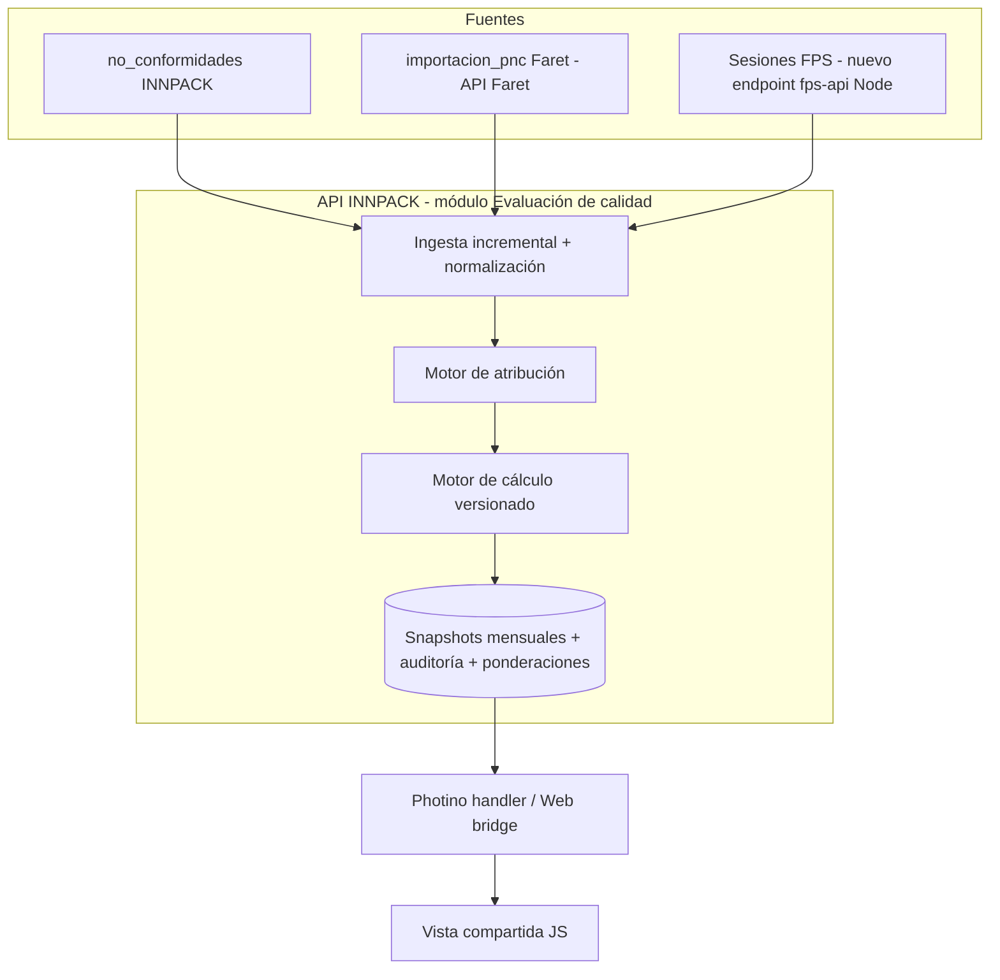
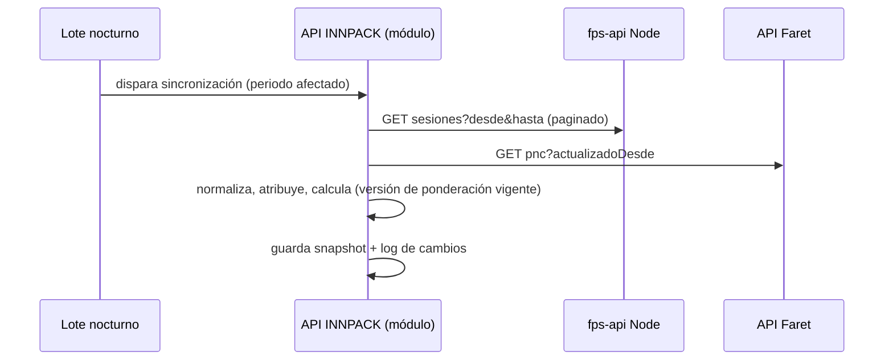

# 03 — Evaluación de arquitecturas

Todas las puntuaciones son **PROPUESTA** (juicio de ingeniería, escala 1–5, mayor = mejor). Los pesos se justifican abajo; si Calidad/TI valoran distinto, el ranking debe recalcularse.

## 1. Alternativas

| | Descripción | Observación crítica |
|---|---|---|
| **A** | Módulo completo en Quality Control: QC calcula y administra; FPS consume resultados por API | QC no tiene la producción por operador (denominador): debe leerla de FPS. Reutiliza JWT, permisos y UI existentes |
| **B** | Módulo completo en FPS | FPS-WEB/Desktop son VB legado sin API; FastAPI es la API de estaciones y no conviene cargarla; las NC de ambas empresas viven en QC. Concentra lógica donde solo "se ve" el resultado |
| **C** | Distribuido: QC administra NC y criterios; FPS relaciona producción/operadores y presenta | Dos puntos de cálculo, contrato de datos a ambos lados, paridad difícil, fuente de verdad del resultado ambigua |
| **D** | Servicio intermedio independiente (nuevo sistema, BD propia) | Mejor aislamiento, pero nuevo despliegue, credenciales, monitoreo y coste operacional en una infraestructura que hoy se despliega con procedimientos manuales supervisados |
| **E** (propuesta) | **Servicio lógico independiente alojado en la API INNPACK existente**: módulo con tablas propias (proyección materializada mensual, versionado de ponderaciones, auditoría), ingesta incremental desde 3 fuentes (NC INNPACK local, `importacion_pnc` Faret por REST, sesiones FPS por un endpoint de solo lectura nuevo en fps-api Node). Consumo desde Photino y Web mediante el patrón passthrough existente | Mantiene una sola implementación de cálculo, reutiliza auth/permisos/despliegue; no añade infraestructura |

## 2. Pesos (suman 100)

| Criterio | Peso | Por qué |
|---|---:|---|
| Integridad de datos | 10 | El resultado evalúa personas: un error es un daño laboral |
| Mantenibilidad | 10 | Hoy ya hay duplicación Desktop/Web e INNPACK/Faret |
| Complejidad | 8 | El equipo despliega con procedimientos manuales supervisados |
| Seguridad | 8 | Datos personales y evaluaciones |
| Reutilización | 8 | Evitar reescribir sistemas |
| Compatibilidad con producción | 8 | Sistemas en operación continua |
| Acoplamiento | 7 | Cambios de FPS no deben romper QC |
| Coste de implementación | 7 | — |
| Rendimiento | 6 | Lecturas pesadas contra producción deben evitarse |
| Escalabilidad | 5 | — |
| Disponibilidad | 5 | — |
| Coste operacional | 5 | — |
| Facilidad de despliegue | 5 | — |
| Capacidad de evolución | 4 | — |
| Riesgo técnico | 4 | — |

## 3. Matriz ponderada

| Criterio (peso) | A | B | C | D | E |
|---|---:|---:|---:|---:|---:|
| Mantenibilidad (10) | 4 | 2 | 3 | 4 | 4 |
| Complejidad (8) | 3 | 2 | 2 | 2 | 3 |
| Seguridad (8) | 4 | 2 | 3 | 3 | 4 |
| Rendimiento (6) | 3 | 3 | 3 | 4 | 4 |
| Escalabilidad (5) | 3 | 3 | 3 | 5 | 4 |
| Reutilización (8) | 4 | 2 | 3 | 4 | 5 |
| Acoplamiento (7) | 3 | 2 | 2 | 4 | 4 |
| Integridad de datos (10) | 4 | 3 | 3 | 5 | 5 |
| Disponibilidad (5) | 4 | 3 | 3 | 3 | 4 |
| Coste implementación (7) | 3 | 2 | 2 | 1 | 4 |
| Coste operacional (5) | 4 | 3 | 3 | 2 | 4 |
| Facilidad despliegue (5) | 3 | 2 | 2 | 2 | 4 |
| Compat. producción (8) | 4 | 2 | 3 | 4 | 4 |
| Evolución (4) | 3 | 2 | 3 | 5 | 4 |
| Riesgo técnico (4) | 3 | 2 | 3 | 3 | 4 |
| **Total ponderado (sobre 5)** | **3,54** | **2,31** | **2,73** | **3,45** | **4,10** |

## 4. Por qué gana E y por qué no las otras

- **vs. B**: FPS no es host viable (VB legado/estaciones), y concentrar lógica allí solo por visualizar es el error que se pidió evitar.
- **vs. C**: duplica la responsabilidad de cálculo; con la paridad Desktop/Web ya costosa, sumar un tercer lugar de lógica es el peor escenario de mantenimiento.
- **vs. A pura**: E es A con tres precisiones: el cálculo vive en la API (no en JS ni en handlers), hay proyección materializada (no consultas pesadas repetidas) y la lectura de FPS pasa por un endpoint acotado.
- **vs. D**: D gana en aislamiento y escalabilidad, pero cuesta una pieza más que operar (servicio, BD, secretos, monitoreo). E se puede **extraer a D después** si el volumen o el gobierno lo exigen, porque el módulo se diseña con tablas y contrato propios.
- **No se recomiendan microservicios**: no hay carga ni equipo que los justifique.

## 5. Riesgos de E

| Riesgo | Mitigación |
|---|---|
| La API INNPACK crece en responsabilidades | Módulo con namespace, tablas y contrato propios; extraíble |
| Faret MySQL no es accesible desde la API INNPACK hoy | Consumir `GET api/importaciones/pnc` (paginado) con cuenta de servicio, o agregar un endpoint de lectura incremental en la API Faret (`updated_since`) |
| FPS caído o lento | Sincronización por lotes nocturnos con ventana, nunca en la petición del usuario; mostrar "última sincronización" |
| Lectura masiva de FPS | Endpoint nuevo con rango de fechas acotado, paginado, solo agregados por sesión, `x-api-key`, límites |
| `API_KEY` ausente deja fps-api abierto | Verificar entorno antes de conectar; exigir clave dedicada (PENDIENTE TI) |
| Cuenta INNPACK compartida (cuenta de servicio en Web Faret) | Resolver permisos con `PermisosModulo`/`PermisosService`; el actor delegado está sin desplegar |

## 6. Diagramas

